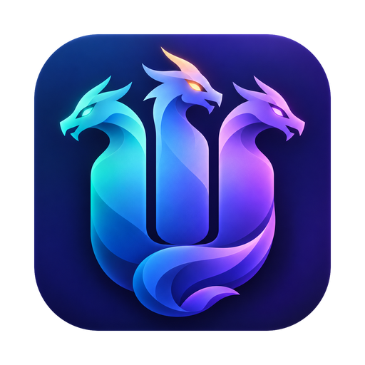
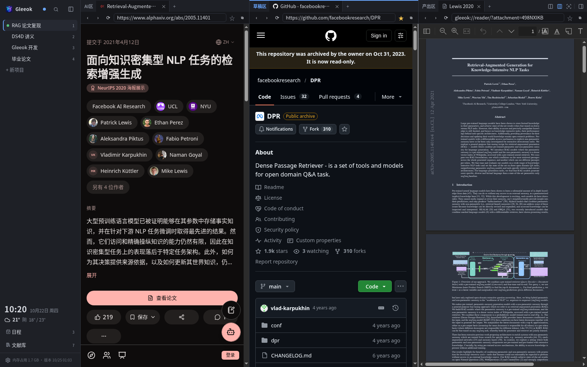
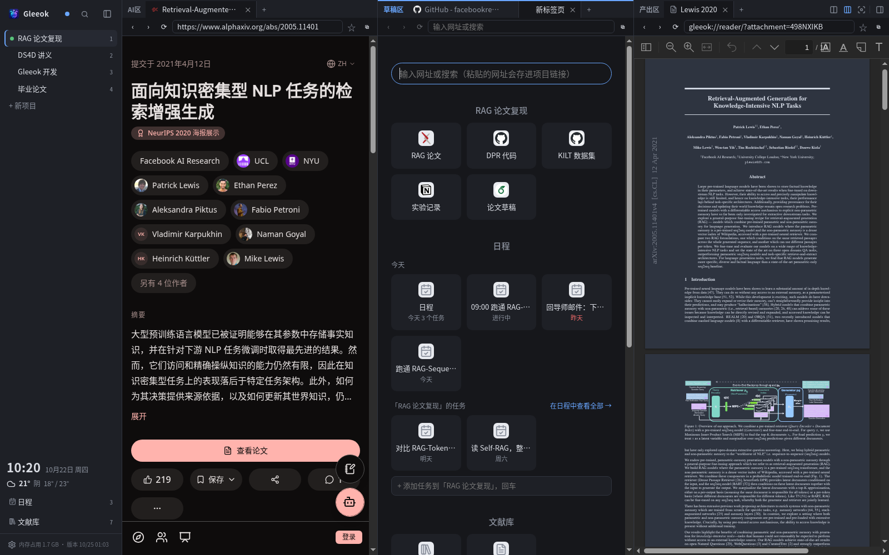
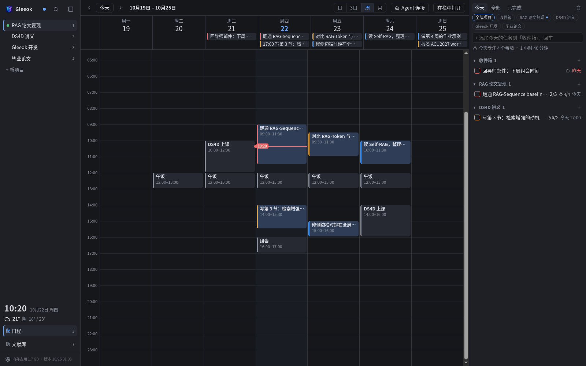
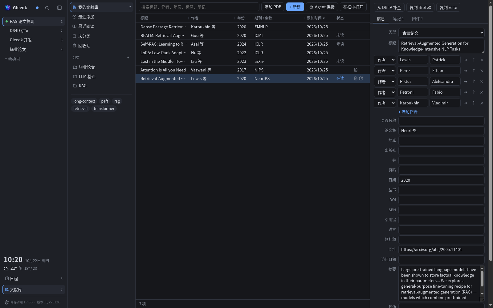
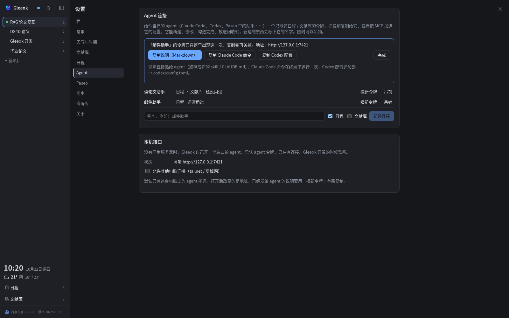

# Gleeok

**把 AI 会话、工具和资料，放进同一个项目工作空间。**

对 AI 来说，一个 Session 或 Terminal 就能承载一个项目；而人还需要 PPT、Overleaf、Zotero 等工具。切换 AI 的项目很简单，但在这些软件里逐一找回对应的文档、资料和工作状态，就麻烦多了。

Gleeok 参考 Paseo 的思路，以项目为单位组织会话、网页、终端和资料，让切换项目时，整套工作环境也能跟着切换。界面采用分栏布局，每一栏都可以拆成独立窗口，移到第二块显示器上。日程、天气和文献库也集成其中，方便日常工作和科研。

Gleeok 基于 Electron，只能整合网页版工具，不过提供内置终端和 PDF 阅读器。对于更多,更专业的需求,欢迎提issue,或者fork之后按自己的工作习惯扩展。



## 功能

- **项目工作区**：分栏布局，每栏拥有独立标签页，支持多显示器。
- **Paseo 与终端**：导入 Paseo 项目，使用本机或 SSH 终端，打开项目对应的代码编辑器。
- **文献库**：分类、标签、PDF 阅读与批注、划词翻译，支持 DBLP 元数据补全和 BibTeX 导出。
- **日程与天气**：任务清单、日历、时间块、番茄钟，以及天气预报和时钟。
- **Agent 接入**：通过 REST 或 MCP，让 Claude Code、Codex 等助手管理日程和文献。
- **本地与同步**：默认本地存储，可选部署多设备同步服务器；支持接入 Bitwarden 兼容密码库。

## 截图

**新标签页**：当前项目的链接、今天的日程（正在进行的时间块、过期任务）和这个项目还没做完的任务，可以直接在这里添加。



**日程**：周视图里排着课、组会和实验；把任务拖进时间轴就能占一段时间，右边按项目分组，番茄钟记录今天专注了多久。



**文献库**：分类、标签、阅读状态，条目信息可以从 DBLP 补全，一键复制 BibTeX / `\cite{}` 到 Overleaf。



**Agent 接入**：在 设置 → Agent 里给你的 agent（Claude Code、Codex、Paseo 里的助手……）新建一个连接，选它能管哪些（日程 / 文献库）。令牌只显示一次，三个按钮任选其一交给 agent：

- **复制说明（Markdown）**：地址、令牌、规矩和接口示例，直接贴给 agent，或存成它的 skill / `CLAUDE.md`；
- **复制 Claude Code 命令**：在终端运行一次 `claude mcp add …`，之后 agent 就有了日程和文献库的 MCP 工具；
- **复制 Codex 配置**：追加到 `~/.codex/config.toml`。

之后就可以对 agent 说「把这封邮件里的截止日期加进日程」「明天上午给我留两小时读 Self-RAG」「把这篇 arXiv 论文存进文献库的 RAG 分类」「我在 RAG 论文里高亮了什么」。agent 能新建、修改、勾选完成、放进回收站，新建的东西带它的名字（日程里的小机器人图标）；每个连接可以随时换新令牌或吊销。没有同步服务器时，Gleeok 在本机 `127.0.0.1:7421` 上为 agent 开一个只认 agent 令牌的端口。详见 [docs/agents.md](docs/agents.md)。



<sub>截图用的是演示数据：公开网页、arXiv 上的论文和虚构的任务。</sub>

## 安装与运行

### 下载安装包

在 [Releases](https://github.com/Suchun-sv/Gleeok/releases/latest) 下载对应系统的安装包，安装后会自动检查更新：

- **macOS**：`mac-arm64.zip`（Apple 芯片）或 `mac-x64.zip`（Intel），解压后把 `Gleeok.app` 拖进「应用程序」。
- **Windows**：`windows-x64-setup.exe`，SmartScreen 提示时点「更多信息 → 仍要运行」。
- **Linux**：`linux-x86_64.AppImage`，`chmod +x` 后直接运行。

> [!IMPORTANT]
> **macOS 第一次打开会被拦下**（Gleeok 没有苹果开发者签名）。请到 **系统设置 → 隐私与安全性**，在页面下方点 **「仍要打开」**。只需一次，之后的自动更新不会再被拦。

### 从源码运行

需要 **Node.js 22+** 和 **Git**。Linux 还需安装 gcc、make 和 Python，用于编译终端依赖。

```sh
git clone https://github.com/Suchun-sv/Gleeok.git ~/github/gleeok
cd ~/github/gleeok/app
npm install
npm run build
npm start
```

无需配置即可使用，数据默认保存在本机。从源码运行时，可在应用内检查更新、构建并重启。

桌面启动器：[Linux](deploy/gleeok-linux.sh) · [Windows](deploy/windows-shortcut.ps1) · [macOS](deploy/macos-launcher.sh)

## 更多说明

- [文献库](docs/library.md)：文献管理、PDF 阅读、批注与翻译。
- [日程](docs/planner.md)：任务、日历、番茄钟与手机访问。
- [Agent 接入](docs/agents.md)：REST、MCP、访问令牌与权限范围。

### 多设备同步（可选）

在各设备均可访问的机器上启动服务器：

```sh
cd ~/github/gleeok/server
npm install
GLEEOK_TOKEN=<随机长字符串> GLEEOK_HOST=<监听地址> npm start
```

然后在每台客户端的 `~/.config/gleeok/client.json` 中填写：

```json
{
  "serverUrl": "http://<服务器地址>:7420",
  "token": "<同一个随机长字符串>"
}
```

### DRM 媒体（可选）

Gleeok 使用支持 Widevine 的 [castLabs Electron](https://github.com/castlabs/electron-releases)。在 macOS 和 Windows 上，部分媒体服务还需要 VMP 签名，详见 [EVS 文档](https://github.com/castlabs/electron-releases/wiki/EVS)。

## License

[GNU AGPL-3.0](LICENSE) · Copyright 2026 Suchun-sv。